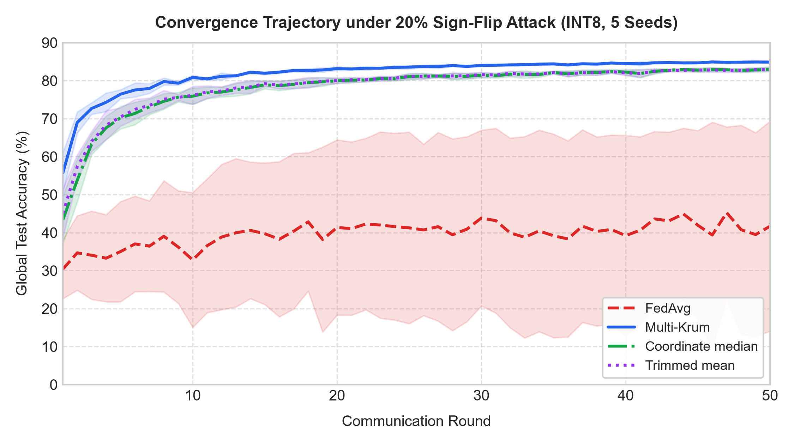
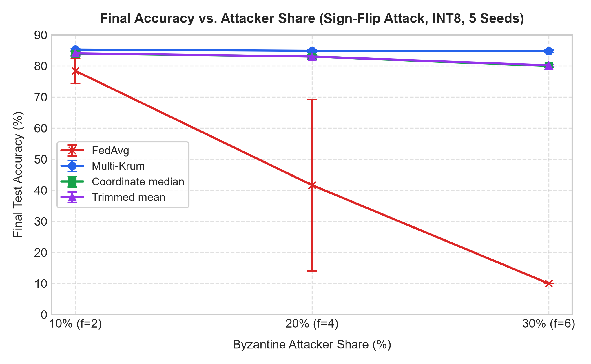
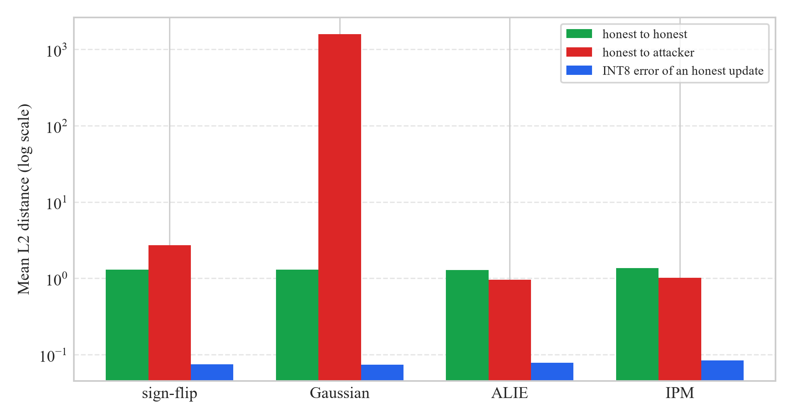
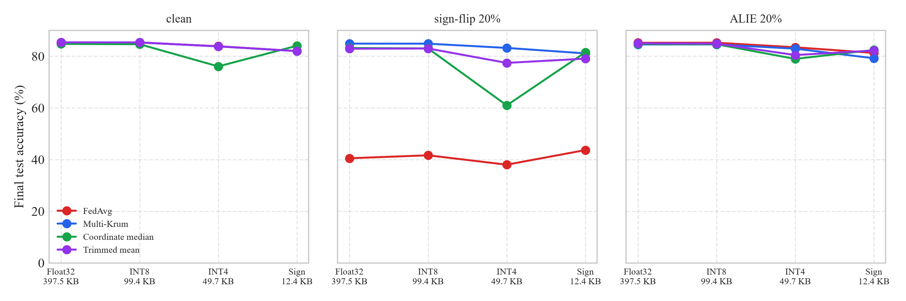

# EdgeFed-Bench: Byzantine-Robust Federated Learning with DuckDB-Partitioned Edge Stores and Quantized Gradients

A simulated federated learning benchmark. It measures whether INT8 compression of client updates weakens Byzantine-robust aggregation. Client data is stored as Parquet shards and read through DuckDB.

---

## 1. Problem and Research Question

Edge clients face two problems at once.

1. **Uplink is scarce.** Mobile and IoT clients often send over links that are up to an order of magnitude slower than the server's downlink (Konečný et al., 2016).
2. **Plain FedAvg trusts every client.** A few faulty or malicious clients can send updates that stop the model from converging (Blanchard et al., NeurIPS 2017).

Quantizing updates to INT8 helps with the first problem, but it adds rounding error to every update. Byzantine-robust aggregators work by spotting updates that look unlike the others, so that error could in principle hide attackers or make honest clients look like outliers.

> **Research question:** does INT8 uniform symmetric quantization of client updates reduce the accuracy or the attacker detection of Byzantine-robust aggregators (Multi-Krum, coordinate-wise median, trimmed mean) under moderate non-IID Dirichlet label skew ($\alpha = 0.5$)?

---

<!-- RESULTS:START -->
## 2. Key Findings (generated from the database)

- **Uplink:** INT8 cuts each client update from 397.5 KB to 99.4 KB per round, a 75.0% reduction. A 50-round run with 20 clients sends 97.1 MB instead of 388.2 MB.
- **Accuracy with INT8:** at 20% sign-flip, Multi-Krum ends at 85.03 +- 0.35% with INT8 and 85.01 +- 0.34% with Float32. Plain FedAvg ends at 10.19% at 30% sign-flip, which is chance level for 10 classes.
- **Defences at 30% sign-flip (INT8):** Multi-Krum 84.44 +- 0.76%, trimmed mean 78.13 +- 2.84%, coordinate median 77.40 +- 3.93%.
- **Multi-Krum attacker rejection (INT8 and Float32 pooled):** 100.0% in the worst Gaussian run. Under sign-flip the mean over seeds is between 94.5% and 99.2%, depending on attacker share, so some sign-flip updates are accepted.
- **Wrong assumed f (actual f = 6):** at assumed f = 2, Multi-Krum ends at 45.72% and trimmed mean at 21.72%. At assumed f = 8 they end at 84.01% and 77.79%.
- **Paired tests (10 seeds):** for Multi-Krum, coordinate median and trimmed mean, the 95% CI of INT8 minus Float32 lies inside +-0.5 accuracy points in 19 of 21 settings. Significant differences after Holm correction: Coordinate median, clean (-0.10); Coordinate median, sign-flip 10% (-0.17); Coordinate median, sign-flip 20% (-0.30); Coordinate median, sign-flip 30% (-0.81); Coordinate median, Gaussian 10% (-0.13); Coordinate median, Gaussian 20% (-0.11); Coordinate median, Gaussian 30% (-0.13). The largest is 0.81 points.
- **Mechanism (Multi-Krum, 20% sign-flip):** the INT8 error of an honest update has L2 norm 0.074, against 1.31 between two honest updates and 2.71 between an honest and an attacker update.
- **ALIE and IPM:** Multi-Krum rejected 0.0% of ALIE and 0.0% of IPM updates at 30%. Under 30% IPM it ends at 80.16% (INT8), below FedAvg at 84.42%.
- **Strong label skew (alpha 0.1):** in clean runs, coordinate median with INT8 ends at 70.53%; INT8 minus Float32 is -3.12 points (5 seeds, p = 0.062, the smallest p possible with that many seeds).
- **INT4 and 1-bit sign:** at 20% sign-flip, Multi-Krum keeps 83.23% with INT4 and 81.10% with Sign; coordinate median falls to 60.99% with INT4 but keeps 81.54% with Sign.
- **Hyperparameters:** on a held-out validation split, our fixed setting ranks 6 of 20 for clean FedAvg, 1.09 points below the best (lr 0.05, momentum 0.9, batch 64).

## 3. Results by Configuration (50 Rounds, 20 Clients, $\alpha = 0.5$, 10 Seeds)

### 3.1. Final Accuracy by Attack and Aggregator (INT8)
Final test accuracy, mean $\pm$ standard deviation over seeds 0 to 9:

| Attack | Share | FedAvg | Multi-Krum | Coordinate Median | Trimmed Mean |
| :--- | :--- | :--- | :--- | :--- | :--- |
| None (Clean) | 0% | 85.18 +- 0.28% | 85.23 +- 0.26% | 84.49 +- 0.51% | 85.25 +- 0.27% |
| Gaussian | 10% | 48.36 +- 3.30% | 85.09 +- 0.37% | 84.35 +- 0.44% | 84.94 +- 0.37% |
| Gaussian | 20% | 39.91 +- 5.18% | 85.18 +- 0.34% | 84.48 +- 0.50% | 84.87 +- 0.32% |
| Gaussian | 30% | 42.00 +- 3.09% | 84.76 +- 0.53% | 84.14 +- 0.93% | 84.42 +- 0.74% |
| sign-flip | 10% | 78.74 +- 5.15% | 85.11 +- 0.36% | 83.67 +- 0.68% | 83.99 +- 0.56% |
| sign-flip | 20% | 36.38 +- 22.91% | 85.03 +- 0.35% | 81.96 +- 2.47% | 82.94 +- 0.82% |
| sign-flip | 30% | 10.19 +- 0.61% | 84.44 +- 0.76% | 77.40 +- 3.93% | 78.13 +- 2.84% |

### 3.2. Float32 versus INT8 at 20% Sign-Flip
INT8 cuts uplink by 75.0%. The Float32 to INT8 accuracy difference is smaller than one standard deviation for every aggregator in this table:

| Aggregator | Float32 Acc | INT8 Acc | Acc Delta | Float32 Uplink (KB) | INT8 Uplink (KB) | Bandwidth Cut |
| :--- | :--- | :--- | :--- | :--- | :--- | :--- |
| FedAvg | 38.54 +- 22.65% | 36.38 +- 22.91% | -2.15% | 397.5 KB | 99.4 KB | -75.0% |
| Multi-Krum | 85.01 +- 0.34% | 85.03 +- 0.35% | +0.01% | 397.5 KB | 99.4 KB | -75.0% |
| Coordinate median | 82.27 +- 2.23% | 81.96 +- 2.47% | -0.30% | 397.5 KB | 99.4 KB | -75.0% |
| Trimmed mean | 82.89 +- 0.78% | 82.94 +- 0.82% | +0.05% | 397.5 KB | 99.4 KB | -75.0% |

### 3.3. Convergence and Attacker Share

<p align="center">
  
  
</p>

### 3.4. Wrong Assumed $f$ (Actual $f=6$, 30% Attackers, Sign-Flip, INT8)
The server is told a number of attackers $f$ that differs from the actual 6:

| Assumed f | Assumed Ratio (f/N) | Multi-Krum Final Acc | Trimmed Mean Final Acc | Setting |
| :--- | :--- | :--- | :--- | :--- |
| 2 | 2/20 (10%) | 45.72 +- 17.65% | 21.72 +- 14.11% | Underestimates attackers (assumed f < actual f = 6) |
| 4 | 4/20 (20%) | 80.23 +- 3.94% | 70.40 +- 15.28% | Underestimates attackers (assumed f < actual f = 6) |
| 6 | 6/20 (30%) | 84.44 +- 0.76% | 78.13 +- 2.84% | Assumed f equals actual f = 6 |
| 8 | 8/20 (40%) | 84.01 +- 1.07% | 77.79 +- 3.71% | Overestimates attackers (assumed f > actual f = 6) |

### 3.5. Multi-Krum Rejection Rates
Attacker rejection and honest false-rejection rates, averaged over all 50 rounds and over seeds, for each wire precision:

| Attack Vector | Attacker Share | Wire | Attacker Rejection Rate (%) | Honest False-Rejection Rate (%) |
| :--- | :--- | :--- | :--- | :--- |
| Gaussian | 10% | Float32 | 100.00 +- 0.00% | 0.00 +- 0.00% |
| Gaussian | 10% | INT8 | 100.00 +- 0.00% | 0.00 +- 0.00% |
| Gaussian | 20% | Float32 | 100.00 +- 0.00% | 0.00 +- 0.00% |
| Gaussian | 20% | INT8 | 100.00 +- 0.00% | 0.00 +- 0.00% |
| Gaussian | 30% | Float32 | 100.00 +- 0.00% | 0.00 +- 0.00% |
| Gaussian | 30% | INT8 | 100.00 +- 0.00% | 0.00 +- 0.00% |
| sign-flip | 10% | Float32 | 99.20 +- 1.87% | 0.09 +- 0.21% |
| sign-flip | 10% | INT8 | 99.20 +- 1.87% | 0.09 +- 0.21% |
| sign-flip | 20% | Float32 | 94.40 +- 9.37% | 1.40 +- 2.34% |
| sign-flip | 20% | INT8 | 94.55 +- 9.34% | 1.36 +- 2.33% |
| sign-flip | 30% | Float32 | 95.60 +- 5.43% | 1.89 +- 2.33% |
| sign-flip | 30% | INT8 | 95.57 +- 5.42% | 1.90 +- 2.32% |

### 3.6. Statistical Test of the INT8 Effect (Main Grid, Paired by Seed)
INT8 accuracy minus Float32 accuracy for the same aggregator, attack and seed. The 95% CI is a paired t interval; p is an exact two-sided sign-flip permutation test; p (Holm) corrects for the seven settings of each aggregator. The last column says whether the whole CI lies within the equivalence margin in accuracy points; we chose that margin ourselves.

| Aggregator | Setting | n | Float32 | INT8 | Diff | 95% CI | p | p (Holm) | Within +-0.5 |
| :--- | :--- | :--- | :--- | :--- | :--- | :--- | :--- | :--- | :--- |
| FedAvg | clean | 10 | 85.23 | 85.18 | -0.05 | [-0.09, -0.01] | 0.041 | 0.287 | yes |
| FedAvg | sign-flip 10% | 10 | 78.79 | 78.74 | -0.05 | [-0.66, +0.57] | 0.832 | 1.000 | no |
| FedAvg | sign-flip 20% | 10 | 38.54 | 36.38 | -2.15 | [-5.88, +1.57] | 0.242 | 1.000 | no |
| FedAvg | sign-flip 30% | 10 | 10.00 | 10.19 | +0.19 | [-0.24, +0.63] | 1.000 | 1.000 | no |
| FedAvg | Gaussian 10% | 10 | 48.58 | 48.36 | -0.22 | [-0.74, +0.29] | 0.492 | 1.000 | no |
| FedAvg | Gaussian 20% | 10 | 39.72 | 39.91 | +0.19 | [-0.08, +0.47] | 0.143 | 0.855 | yes |
| FedAvg | Gaussian 30% | 10 | 41.87 | 42.00 | +0.13 | [-0.18, +0.44] | 0.387 | 1.000 | yes |
| Multi-Krum | clean | 10 | 85.23 | 85.23 | -0.00 | [-0.06, +0.06] | 1.000 | 1.000 | yes |
| Multi-Krum | sign-flip 10% | 10 | 85.14 | 85.11 | -0.03 | [-0.08, +0.03] | 0.312 | 1.000 | yes |
| Multi-Krum | sign-flip 20% | 10 | 85.01 | 85.03 | +0.01 | [-0.06, +0.09] | 0.691 | 1.000 | yes |
| Multi-Krum | sign-flip 30% | 10 | 84.43 | 84.44 | +0.01 | [-0.06, +0.08] | 0.719 | 1.000 | yes |
| Multi-Krum | Gaussian 10% | 10 | 85.11 | 85.09 | -0.02 | [-0.09, +0.05] | 0.500 | 1.000 | yes |
| Multi-Krum | Gaussian 20% | 10 | 85.19 | 85.18 | -0.01 | [-0.10, +0.07] | 0.801 | 1.000 | yes |
| Multi-Krum | Gaussian 30% | 10 | 84.81 | 84.76 | -0.05 | [-0.11, +0.01] | 0.094 | 0.656 | yes |
| Coordinate median | clean | 10 | 84.59 | 84.49 | -0.10 | [-0.18, -0.01] | 0.027 | 0.047 | yes |
| Coordinate median | sign-flip 10% | 10 | 83.84 | 83.67 | -0.17 | [-0.27, -0.07] | 0.006 | 0.035 | yes |
| Coordinate median | sign-flip 20% | 10 | 82.27 | 81.96 | -0.30 | [-0.50, -0.11] | 0.006 | 0.035 | yes |
| Coordinate median | sign-flip 30% | 10 | 78.20 | 77.40 | -0.81 | [-1.44, -0.17] | 0.002 | 0.014 | no |
| Coordinate median | Gaussian 10% | 10 | 84.49 | 84.35 | -0.13 | [-0.21, -0.06] | 0.010 | 0.039 | yes |
| Coordinate median | Gaussian 20% | 10 | 84.59 | 84.48 | -0.11 | [-0.18, -0.03] | 0.018 | 0.047 | yes |
| Coordinate median | Gaussian 30% | 10 | 84.27 | 84.14 | -0.13 | [-0.24, -0.02] | 0.016 | 0.047 | yes |
| Trimmed mean | clean | 10 | 85.26 | 85.25 | -0.00 | [-0.07, +0.06] | 0.977 | 1.000 | yes |
| Trimmed mean | sign-flip 10% | 10 | 84.02 | 83.99 | -0.03 | [-0.10, +0.03] | 0.268 | 1.000 | yes |
| Trimmed mean | sign-flip 20% | 10 | 82.89 | 82.94 | +0.05 | [-0.04, +0.15] | 0.268 | 1.000 | yes |
| Trimmed mean | sign-flip 30% | 10 | 78.37 | 78.13 | -0.24 | [-0.53, +0.05] | 0.074 | 0.520 | no |
| Trimmed mean | Gaussian 10% | 10 | 84.95 | 84.94 | -0.00 | [-0.09, +0.09] | 0.980 | 1.000 | yes |
| Trimmed mean | Gaussian 20% | 10 | 84.91 | 84.87 | -0.04 | [-0.12, +0.04] | 0.305 | 1.000 | yes |
| Trimmed mean | Gaussian 30% | 10 | 84.49 | 84.42 | -0.07 | [-0.15, +0.01] | 0.088 | 0.527 | yes |

### 3.7. Why INT8 Does Not Hide Attackers: Distances Between Updates
Multi-Krum, 20% attackers, alpha 0.5, MLP. Mean L2 distances per round, averaged over rounds and seeds. Codec error is the L2 norm of an honest update's compression error (0 for Float32). Only runs executed after distance logging was added are included (grid seeds 5 to 9 and the extended experiments).

| Attack | Wire | Runs | Honest-honest | Honest-attacker | Codec error | Error / honest-honest | Attacker / honest-honest |
| :--- | :--- | :--- | :--- | :--- | :--- | :--- | :--- |
| sign-flip | Float32 | 5 | 1.30 | 2.71 | 0.000 | 0.000 | 2.08 |
| sign-flip | INT8 | 5 | 1.31 | 2.71 | 0.074 | 0.057 | 2.08 |
| sign-flip | INT4 | 5 | 1.26 | 2.72 | 0.768 | 0.609 | 2.16 |
| sign-flip | Sign | 5 | 0.75 | 1.68 | 1.133 | 1.509 | 2.24 |
| Gaussian | Float32 | 5 | 1.30 | 1595.04 | 0.000 | 0.000 | 1228.84 |
| Gaussian | INT8 | 5 | 1.30 | 1595.12 | 0.074 | 0.057 | 1224.10 |
| ALIE | Float32 | 5 | 1.29 | 0.95 | 0.000 | 0.000 | 0.74 |
| ALIE | INT8 | 5 | 1.29 | 0.95 | 0.078 | 0.061 | 0.74 |
| ALIE | INT4 | 5 | 1.31 | 0.98 | 0.802 | 0.611 | 0.75 |
| ALIE | Sign | 5 | 0.78 | 0.59 | 1.224 | 1.564 | 0.75 |
| IPM | Float32 | 5 | 1.36 | 1.02 | 0.000 | 0.000 | 0.75 |
| IPM | INT8 | 5 | 1.36 | 1.02 | 0.084 | 0.062 | 0.75 |

<p align="center"></p>

### 3.8. Attacks Built to Look Honest: ALIE and IPM
Final test accuracy, mean +- standard deviation over seeds 0 to 4. Diff is INT8 minus Float32, paired by seed; p is the exact permutation p-value.

| Aggregator | Attack | Float32 | INT8 | Diff | p | Multi-Krum rejection % |
| :--- | :--- | :--- | :--- | :--- | :--- | :--- |
| FedAvg | ALIE 10% | 85.25 +- 0.41 | 85.32 +- 0.32 | +0.06 | 0.312 | - |
| FedAvg | ALIE 20% | 85.21 +- 0.36 | 85.24 +- 0.29 | +0.03 | 0.938 | - |
| FedAvg | ALIE 30% | 85.22 +- 0.27 | 85.17 +- 0.35 | -0.05 | 0.312 | - |
| FedAvg | IPM 10% | 85.11 +- 0.44 | 85.10 +- 0.47 | -0.00 | 1.000 | - |
| FedAvg | IPM 20% | 84.79 +- 0.23 | 84.74 +- 0.26 | -0.05 | 0.375 | - |
| FedAvg | IPM 30% | 84.47 +- 0.32 | 84.42 +- 0.29 | -0.06 | 0.125 | - |
| Multi-Krum | ALIE 10% | 85.03 +- 0.40 | 84.92 +- 0.47 | -0.10 | 0.438 | 0.0 |
| Multi-Krum | ALIE 20% | 84.56 +- 0.55 | 84.58 +- 0.56 | +0.02 | 0.938 | 0.0 |
| Multi-Krum | ALIE 30% | 84.24 +- 0.67 | 84.28 +- 0.64 | +0.04 | 0.688 | 0.0 |
| Multi-Krum | IPM 10% | 84.65 +- 0.49 | 84.55 +- 0.49 | -0.10 | 0.125 | 0.0 |
| Multi-Krum | IPM 20% | 83.44 +- 0.83 | 83.55 +- 0.88 | +0.12 | 0.125 | 0.0 |
| Multi-Krum | IPM 30% | 80.48 +- 1.29 | 80.16 +- 1.31 | -0.32 | 0.500 | 0.0 |
| Coordinate median | ALIE 10% | 84.99 +- 0.28 | 84.90 +- 0.27 | -0.09 | 0.125 | - |
| Coordinate median | ALIE 20% | 84.75 +- 0.15 | 84.63 +- 0.23 | -0.11 | 0.062 | - |
| Coordinate median | ALIE 30% | 83.71 +- 0.33 | 83.52 +- 0.44 | -0.19 | 0.062 | - |
| Coordinate median | IPM 10% | 84.04 +- 0.47 | 83.82 +- 0.50 | -0.22 | 0.062 | - |
| Coordinate median | IPM 20% | 82.32 +- 0.56 | 82.07 +- 0.60 | -0.25 | 0.062 | - |
| Coordinate median | IPM 30% | 76.20 +- 3.23 | 75.68 +- 3.16 | -0.52 | 0.062 | - |
| Trimmed mean | ALIE 10% | 85.09 +- 0.26 | 85.15 +- 0.37 | +0.06 | 0.375 | - |
| Trimmed mean | ALIE 20% | 85.01 +- 0.14 | 84.88 +- 0.24 | -0.14 | 0.188 | - |
| Trimmed mean | ALIE 30% | 84.40 +- 0.43 | 84.22 +- 0.50 | -0.17 | 0.125 | - |
| Trimmed mean | IPM 10% | 84.74 +- 0.35 | 84.77 +- 0.40 | +0.04 | 0.375 | - |
| Trimmed mean | IPM 20% | 84.05 +- 0.27 | 84.07 +- 0.28 | +0.02 | 0.500 | - |
| Trimmed mean | IPM 30% | 81.87 +- 0.78 | 81.76 +- 0.76 | -0.11 | 0.125 | - |

### 3.9. Label Skew: Dirichlet Alpha 0.1, 0.5 and 1.0
Final INT8 accuracy (mean over seeds 0 to 4) and INT8 minus Float32 (diff). Alpha 0.5 values come from the main grid and the ALIE runs with the same seeds.

| Aggregator | Setting | a=0.1 INT8 | diff | a=0.5 INT8 | diff | a=1.0 INT8 | diff |
| :--- | :--- | :--- | :--- | :--- | :--- | :--- | :--- |
| FedAvg | clean | 81.66 | -0.39 | 85.30 | -0.07 | 85.81 | +0.06 |
| FedAvg | sign-flip 20% | 10.01 | -2.24 | 41.67 | +1.15 | 55.69 | -0.59 |
| FedAvg | ALIE 20% | 80.29 | -0.23 | 85.24 | +0.03 | 85.71 | -0.02 |
| Multi-Krum | clean | 81.85 | -0.01 | 85.35 | -0.03 | 85.74 | -0.00 |
| Multi-Krum | sign-flip 20% | 79.50 | +1.36 | 84.87 | -0.02 | 85.68 | -0.07 |
| Multi-Krum | ALIE 20% | 78.56 | +0.00 | 84.58 | +0.02 | 85.44 | -0.05 |
| Coordinate median | clean | 70.53 | -3.12 | 84.65 | -0.12 | 85.44 | -0.07 |
| Coordinate median | sign-flip 20% | 62.93 | -2.18 | 83.03 | -0.18 | 84.31 | -0.19 |
| Coordinate median | ALIE 20% | 74.97 | -1.35 | 84.63 | -0.11 | 85.53 | +0.04 |
| Trimmed mean | clean | 81.84 | -0.02 | 85.36 | -0.03 | 85.75 | -0.03 |
| Trimmed mean | sign-flip 20% | 71.55 | -0.05 | 83.01 | +0.09 | 84.13 | -0.12 |
| Trimmed mean | ALIE 20% | 79.45 | -0.18 | 84.88 | -0.14 | 85.71 | -0.03 |

### 3.10. Fewer Bits: INT4 and 1-Bit Sign
Final test accuracy, mean +- standard deviation over seeds 0 to 4. Payload per client per round in the header.

| Aggregator | Setting | Float32 (397.5 KB) | INT8 (99.4 KB) | INT4 (49.7 KB) | Sign (12.4 KB) |
| :--- | :--- | :--- | :--- | :--- | :--- |
| FedAvg | clean | 85.37 +- 0.29 | 85.30 +- 0.31 | 83.88 +- 0.60 | 81.99 +- 0.65 |
| FedAvg | sign-flip 20% | 40.51 +- 28.25 | 41.67 +- 27.62 | 38.03 +- 24.03 | 43.68 +- 12.82 |
| FedAvg | ALIE 20% | 85.21 +- 0.36 | 85.24 +- 0.29 | 83.47 +- 0.59 | 81.29 +- 0.33 |
| Multi-Krum | clean | 85.38 +- 0.31 | 85.35 +- 0.25 | 83.81 +- 0.58 | 82.00 +- 0.63 |
| Multi-Krum | sign-flip 20% | 84.89 +- 0.24 | 84.87 +- 0.28 | 83.23 +- 0.44 | 81.10 +- 0.96 |
| Multi-Krum | ALIE 20% | 84.56 +- 0.55 | 84.58 +- 0.56 | 82.93 +- 1.05 | 79.23 +- 0.91 |
| Coordinate median | clean | 84.77 +- 0.35 | 84.65 +- 0.44 | 76.07 +- 2.93 | 84.06 +- 0.48 |
| Coordinate median | sign-flip 20% | 83.21 +- 0.62 | 83.03 +- 0.67 | 60.99 +- 7.32 | 81.54 +- 0.76 |
| Coordinate median | ALIE 20% | 84.75 +- 0.15 | 84.63 +- 0.23 | 78.98 +- 1.09 | 82.44 +- 0.20 |
| Trimmed mean | clean | 85.39 +- 0.30 | 85.36 +- 0.27 | 83.82 +- 0.62 | 82.00 +- 0.62 |
| Trimmed mean | sign-flip 20% | 82.92 +- 0.55 | 83.01 +- 0.44 | 77.43 +- 1.68 | 79.08 +- 0.84 |
| Trimmed mean | ALIE 20% | 85.01 +- 0.14 | 84.88 +- 0.24 | 80.47 +- 1.06 | 82.20 +- 0.43 |

<p align="center"></p>

### 3.11. A Second Model: Small CNN
Final test accuracy of a 20,522-parameter CNN, mean +- standard deviation. This study uses fewer seeds and rounds than the MLP grid to limit CPU time.

| Aggregator | Setting | Float32 | INT8 | Diff |
| :--- | :--- | :--- | :--- | :--- |
| FedAvg | clean | 84.83 +- 0.30 | 84.84 +- 0.33 | +0.01 |
| FedAvg | sign-flip 20% | 38.87 +- 26.04 | 37.26 +- 24.81 | -1.61 |
| FedAvg | ALIE 20% | 84.86 +- 0.84 | 84.83 +- 0.80 | -0.04 |
| Multi-Krum | clean | 84.81 +- 0.27 | 84.83 +- 0.35 | +0.02 |
| Multi-Krum | sign-flip 20% | 84.71 +- 0.66 | 84.71 +- 0.57 | +0.00 |
| Multi-Krum | ALIE 20% | 83.89 +- 0.73 | 84.01 +- 0.54 | +0.13 |
| Coordinate median | clean | 84.11 +- 0.52 | 83.83 +- 0.47 | -0.28 |
| Coordinate median | sign-flip 20% | 80.55 +- 1.67 | 79.73 +- 2.01 | -0.82 |
| Coordinate median | ALIE 20% | 83.59 +- 0.46 | 83.63 +- 0.40 | +0.04 |
| Trimmed mean | clean | 84.83 +- 0.27 | 84.92 +- 0.32 | +0.08 |
| Trimmed mean | sign-flip 20% | 80.85 +- 1.35 | 80.67 +- 1.47 | -0.18 |
| Trimmed mean | ALIE 20% | 84.18 +- 0.60 | 84.34 +- 0.57 | +0.16 |

### 3.12. Longer Training: 150 Rounds
Mean test accuracy over seeds 0 to 4 at rounds 50, 100 and 150.

| Aggregator | Setting | Wire | Round 50 | Round 100 | Round 150 | Gain 50 to 150 |
| :--- | :--- | :--- | :--- | :--- | :--- | :--- |
| Multi-Krum | clean | Float32 | 85.38 | 86.84 | 87.52 | +2.14 |
| Multi-Krum | clean | INT8 | 85.32 | 86.85 | 87.50 | +2.18 |
| Multi-Krum | sign-flip 20% | Float32 | 84.89 | 86.31 | 87.09 | +2.20 |
| Multi-Krum | sign-flip 20% | INT8 | 84.87 | 86.34 | 87.11 | +2.23 |
| Coordinate median | clean | Float32 | 84.72 | 86.33 | 86.86 | +2.14 |
| Coordinate median | clean | INT8 | 84.61 | 86.07 | 86.72 | +2.11 |
| Coordinate median | sign-flip 20% | Float32 | 83.17 | 84.47 | 85.03 | +1.85 |
| Coordinate median | sign-flip 20% | INT8 | 83.06 | 84.21 | 84.72 | +1.66 |
| Trimmed mean | clean | Float32 | 85.35 | 86.87 | 87.53 | +2.18 |
| Trimmed mean | clean | INT8 | 85.33 | 86.83 | 87.51 | +2.18 |
| Trimmed mean | sign-flip 20% | Float32 | 83.00 | 84.26 | 85.03 | +2.03 |
| Trimmed mean | sign-flip 20% | INT8 | 83.00 | 84.30 | 85.01 | +2.01 |

### 3.13. Hyperparameter Check on a Validation Split
Clean FedAvg, Float32. 10,000 training images are held out as a validation set before partitioning; accuracy here is validation accuracy, not test accuracy.

| Rank | lr | Momentum | Batch | Validation acc | Seeds |
| :--- | :--- | :--- | :--- | :--- | :--- |
| 1 | 0.05 | 0.9 | 64 | 86.65 +- 0.15 | 3 |
| 2 | 0.1 | 0.9 | 64 | 86.51 +- 0.15 | 3 |
| 3 | 0.1 | 0.9 | 128 | 85.95 +- 0.09 | 3 |
| 4 | 0.2 | 0 | 64 | 85.76 +- 0.19 | 3 |
| 5 | 0.02 | 0.9 | 64 | 85.64 +- 0.22 | 3 |
| 6 | 0.05 | 0.9 | 128 | 85.56 +- 0.04 | 3 |
| 7 | 0.1 | 0 | 64 | 84.79 +- 0.13 | 3 |
| 8 | 0.01 | 0.9 | 64 | 84.43 +- 0.26 | 3 |
| 9 | 0.2 | 0 | 128 | 84.18 +- 0.33 | 3 |
| 10 | 0.02 | 0.9 | 128 | 84.00 +- 0.22 | 3 |
| 11 | 0.05 | 0 | 64 | 83.43 +- 0.06 | 3 |
| 12 | 0.2 | 0.9 | 128 | 83.41 +- 2.02 | 3 |
| 13 | 0.1 | 0 | 128 | 83.10 +- 0.13 | 3 |
| 14 | 0.01 | 0.9 | 128 | 82.54 +- 0.19 | 3 |
| 15 | 0.05 | 0 | 128 | 81.59 +- 0.02 | 3 |
| 16 | 0.02 | 0 | 64 | 81.33 +- 0.21 | 3 |
| 17 | 0.01 | 0 | 64 | 78.64 +- 0.24 | 3 |
| 18 | 0.02 | 0 | 128 | 78.52 +- 0.22 | 3 |
| 19 | 0.2 | 0.9 | 64 | 75.23 +- 1.03 | 3 |
| 20 | 0.01 | 0 | 128 | 74.64 +- 0.29 | 3 |

<!-- RESULTS:END -->

## 4. Systems & Data Engineering Architecture

```
edgefed-bench/
├── requirements.txt
├── simulate.py                   # Quick 4-regime check with telemetry logging
├── data/                         # Parquet client shards, test split, telemetry (generated)
├── engine/
│   ├── storage.py                # Dirichlet partitioner, validation split, Parquet I/O, DuckDB EdgeStore
│   ├── quantization.py           # Uniform symmetric INT8 quantizer and error metrics
│   ├── compression.py            # Wire formats: Float32, INT8, INT4, 1-bit sign
│   ├── client.py                 # MLP and CNN models, local SGD
│   ├── adversary.py              # Sign-flip, Gaussian, ALIE and IPM attacks
│   └── aggregator.py             # FedAvg, Coordinate Median, Trimmed Mean, Multi-Krum
├── experiments/
│   ├── config.yaml               # Main grid, wrong-f and extended experiment definitions
│   ├── run_grid.py               # Resumable, shardable runner; writes results/results.duckdb
│   ├── merge_results.py          # Merges shard databases into the main results file
│   ├── partition_stats.py        # Records label skew per client in the results file
│   ├── stats.py                  # Paired CIs, exact permutation tests, Holm correction
│   ├── extended_analysis.py      # Tables and figures for the extended study
│   └── make_report_assets.py     # Figures, README tables, report data from the database
├── docs/                         # Report notes and related work
├── results/                      # results.duckdb, figures, ENVIRONMENT.md
├── report/                       # Typst report, generated tables and summary_metrics.json
└── tests/                        # Unit and regression tests
```

### Why Parquet and DuckDB

Each client's partition is a separate Snappy-compressed Parquet file (`client_00.parquet` to `client_19.parquet`), one directory per seed. This keeps a partition fixed on disk once it is built, so every run with the same seed trains on exactly the same data. `EdgeStore` reads a shard with DuckDB's `.fetchnumpy()`, which returns NumPy arrays without converting row by row in Python. We have not benchmarked read time.

### Telemetry

`simulate.py` writes per-client telemetry (update norm, payload size, local loss) to the `round_telemetry` table and per-round evaluation (accuracy, loss, aggregator, attacker fraction, duration) to the `global_eval` table, both in `data/telemetry.duckdb`. Its summary table also prints a Multi-Krum mitigation rate: the share of rounds in which no attacker was selected. That rate is not stored. It shows as n/a for aggregators that do not select clients. Grid results are stored separately in `results/results.duckdb`.

---

## 5. Methods

### 5.1. INT8 Uniform Symmetric Quantization

Each client update $\mathbf{x} \in \mathbb{R}^D$ uses one scale for the whole vector. Rounding is to the nearest integer, so it is deterministic:

$$\alpha = \max_{i} |x_i|, \quad S = \frac{\alpha}{127}$$

$$q_i = \text{clip}\left(\left\lfloor \frac{x_i}{S} \right\rceil, -127, 127\right) \in \mathbb{Z}_{\text{int8}}$$

$$\hat{x}_i = q_i \cdot S \in \mathbb{R}_{\text{float32}}$$

The error on each element is at most half a step:
$$|x_i - \hat{x}_i| \le \frac{S}{2} = \frac{\alpha}{254}$$

### 5.2. Multi-Krum

For $N$ client updates $\{\mathbf{v}_1, \dots, \mathbf{v}_N\}$ and an assumed number of attackers $f$ with $2f + 2 < N$:

1. Compute all pairwise squared Euclidean distances in 64-bit floats:
   $$d_{ij}^2 = \|\mathbf{v}_i - \mathbf{v}_j\|_2^2 = \|\mathbf{v}_i\|_2^2 + \|\mathbf{v}_j\|_2^2 - 2 \langle \mathbf{v}_i, \mathbf{v}_j \rangle$$
2. Score each client $i$ by the sum of distances to its $N - f - 2$ nearest neighbours:
   $$s(i) = \sum_{k=1}^{N - f - 2} d_{i, (k)}^2$$
3. Average the $m = N - f$ updates with the lowest scores:
   $$\mathbf{v}_{\text{agg}} = \frac{1}{m} \sum_{i \in \text{Selected}} \mathbf{v}_i$$

---

## 6. Limitations

1. **One machine.** All clients run as a simulation on one computer, not on edge hardware such as a Raspberry Pi or Jetson. Network delay, packet loss and thermal throttling are not modelled.
2. **One dataset, two small models.** Everything uses Fashion-MNIST. The main model is a 101,770-parameter MLP; Section 3.11 adds a 20,522-parameter CNN with fewer seeds and rounds. Larger networks or other datasets may behave differently.
3. **Seeds.** The main grid and the wrong-f experiment use 10 seeds; the extended experiments use 5 (the CNN uses 3). The equivalence margin in Section 3.6 was chosen after seeing seeds 0 to 4, so seeds 5 to 9 serve as the confirmation.
4. **The server knows f.** Outside the wrong-f experiment, the aggregator is given the true number of attackers.
5. **Omniscient strong attacks.** ALIE and IPM attackers see every client's true update in the round. That is the strongest version of these attacks, not the most realistic one.
6. **Hyperparameters.** Learning rate, momentum and batch size were fixed before this study. Section 3.13 checks them on a held-out validation split for clean FedAvg only, not for every aggregator and attack.
7. **No error feedback, no differential privacy.** The INT4 and sign formats are used without error feedback, which the compression literature uses to recover accuracy. We add no clipping or privacy noise.
8. **`simulate.py` is a quick check.** It defaults to 5 rounds; its numbers are not the published results.

---

## 7. Reproducing the Results

### 7.1. Setup

```bash
git clone https://github.com/Rajchhapariya/edgefed-bench.git
cd edgefed-bench
pip install -r requirements.txt
```

`requirements.txt` pins the exact versions used for the stored results.

### 7.2. Tests

```bash
python -m unittest discover tests -v
```

The tests cover storage and partitioning, the validation split, every wire format, all four attacks, all four aggregators, both models, the simulation loop, the runner and merger, and the statistics. Some tests build shards under `data/` and download Fashion-MNIST the first time.

### 7.3. Running the Experiments

`experiments/config.yaml` defines 1,432 runs: the main grid (560), wrong-f (80), and six extended experiments. Each finished run is stored under a config hash, so a stopped job resumes where it left off. Runs are bit-for-bit repeatable on the same machine at the same PyTorch thread count; each run's thread count is stored in the `torch_threads` column.

Single process:

```bash
python experiments/run_grid.py --experiment everything --dry_run
python experiments/run_grid.py --experiment everything --threads 10
```

Several processes in parallel, each writing its own file, then merged (this is how the extended study was run, with 8 processes at 2 threads each):

```bash
python experiments/run_grid.py --experiment everything --threads 2 --shard 0/8 --db_path shard_0.duckdb --skip_db results/results.duckdb
python experiments/merge_results.py results/results.duckdb shard_0.duckdb shard_1.duckdb shard_2.duckdb shard_3.duckdb shard_4.duckdb shard_5.duckdb shard_6.duckdb shard_7.duckdb
```

Then record label skew and rebuild every table, figure and report number:

```bash
python experiments/partition_stats.py
python experiments/make_report_assets.py
```

`simulate.py` runs four short regimes (clean FedAvg, attacked FedAvg, Multi-Krum in Float32 and in INT8) as a quick check. Its numbers are not the grid results:

```bash
python simulate.py --rounds 5 --clients 20 --alpha 0.5
```

### 7.4. Querying the Results

```python
import duckdb

con = duckdb.connect("results/results.duckdb", read_only=True)
print(con.execute("""
    SELECT aggregator, attack, attacker_share, wire_precision,
           COUNT(*) AS runs, ROUND(AVG(final_accuracy), 2) AS mean_acc
    FROM runs
    WHERE experiment_type = 'grid'
    GROUP BY ALL
    ORDER BY 1, 2, 3, 4
""").fetchdf())
con.close()
```

---

## 8. Selected References

`docs/RELATED_WORK.md` positions this work against prior studies, with every citation checked against its publisher or arXiv listing.

1. **Blanchard, P., El Mhamdi, E. M., Guerraoui, R., & Stainer, J. (2017).** Machine learning with adversaries: Byzantine tolerant gradient descent. _Advances in Neural Information Processing Systems (NeurIPS 2017)_, 30.
2. **McMahan, B., Moore, E., Ramage, D., Hampson, S., & y Arcas, B. A. (2017).** Communication-efficient learning of deep networks from decentralized data. _Artificial Intelligence and Statistics (AISTATS 2017)_, 1273-1282.
3. **Konečný, J., McMahan, H. B., Yu, F. X., Richtárik, P., Suresh, A. T., & Bacon, D. (2016).** Federated learning: Strategies for improving communication efficiency. _arXiv preprint arXiv:1610.05492_.
4. **Bernstein, J., Wang, Y. X., Azizzadenesheli, K., & Anandkumar, A. (2018).** signSGD: Compressed optimisation for non-convex problems. _International Conference on Machine Learning (ICML 2018)_, 560-569.
5. **Raasveldt, M., & Mühleisen, H. (2019).** DuckDB: an embeddable analytical database. _Proceedings of the 2019 International Conference on Management of Data (SIGMOD 2019)_, 1981-1984.
6. **Yin, D., Chen, Y., Kannan, R., & Bartlett, P. (2018).** Byzantine-robust distributed learning: Towards optimal statistical rates. _ICML 2018_, PMLR 80:5650-5659.
7. **Baruch, M., Baruch, G., & Goldberg, Y. (2019).** A little is enough: Circumventing defenses for distributed learning. _NeurIPS 2019_.
8. **Xie, C., Koyejo, O., & Gupta, I. (2019).** Fall of empires: Breaking Byzantine-tolerant SGD by inner product manipulation. _UAI 2019_, PMLR 115:261-270.
9. **Karimireddy, S. P., He, L., & Jaggi, M. (2022).** Byzantine-robust learning on heterogeneous datasets via bucketing. _ICLR 2022_.
10. **Alistarh, D., Grubic, D., Li, J., Tomioka, R., & Vojnovic, M. (2017).** QSGD: Communication-efficient SGD via gradient quantization and encoding. _NIPS 2017_, 1709-1720.
11. **Bernstein, J., Zhao, J., Azizzadenesheli, K., & Anandkumar, A. (2019).** signSGD with majority vote is communication efficient and fault tolerant. _ICLR 2019_.
12. **Karimireddy, S. P., Rebjock, Q., Stich, S. U., & Jaggi, M. (2019).** Error feedback fixes SignSGD and other gradient compression schemes. _ICML 2019_.
13. **Ghosh, A., Maity, R. K., Kadhe, S., Mazumdar, A., & Ramchandran, K. (2021).** Communication-efficient and Byzantine-robust distributed learning with error feedback. _IEEE Journal on Selected Areas in Information Theory_, 2(3).
14. **Zhu, H., & Ling, Q. (2023).** Byzantine-robust distributed learning with compression. _IEEE Transactions on Signal and Information Processing over Networks_. DOI 10.1109/TSIPN.2023.3265892.
15. **Hsu, T.-M. H., Qi, H., & Brown, M. (2019).** Measuring the effects of non-identical data distribution for federated visual classification. _arXiv:1909.06335_.

License: MIT
