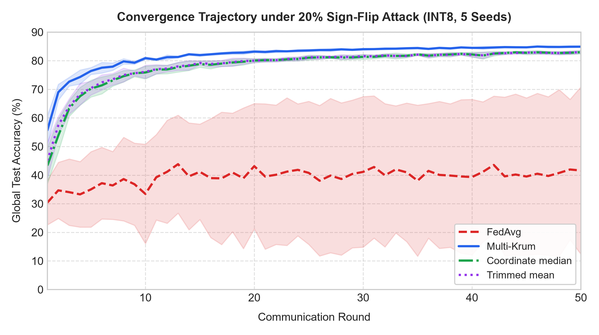
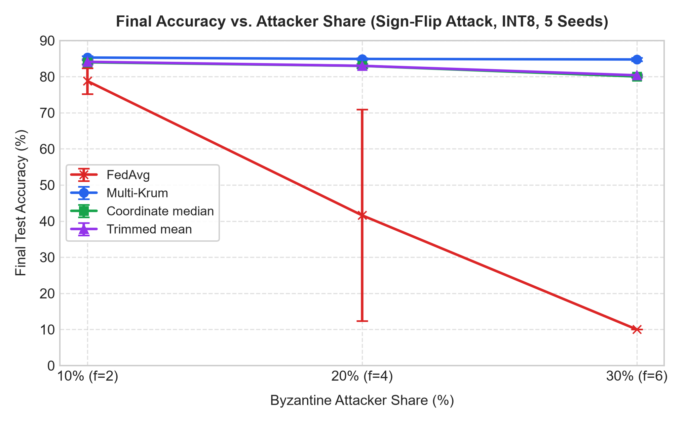

# EdgeFed-Bench: Byzantine-Robust Federated Learning with DuckDB-Partitioned Edge Stores and Quantized Gradients

A reproducible research benchmark evaluating gradient compression trade-offs in Byzantine-tolerant federated learning over columnar edge storage engines.

---

## 1. Problem Formulation & Research Question

Federated learning systems deployed on heterogeneous edge devices face two simultaneous bottlenecks:

1. **Uplink Bandwidth Bottleneck:** Edge and mobile clients operate over constrained cellular or IoT networks where uplink bandwidth is up to an order of magnitude slower and more metered than central server broadcast downlink (Konečný et al., 2016).
2. **Adversarial Vulnerability:** Central aggregators using standard Federated Averaging (FedAvg) are vulnerable to Byzantine manipulation, where rogue or malfunctioning nodes transmit arbitrarily poisoned updates that invert or destabilize model convergence (Blanchard et al., NeurIPS 2017).

While uniform gradient quantization reduces transmission volume, it introduces quantization noise into local parameter deltas. This project evaluates:

> **Does INT8 uniform symmetric gradient quantization degrade the mathematical outlier-detection guarantees and convergence stability of Byzantine-resilient aggregators (Multi-Krum, Coordinate-wise Median) under severe non-IID Dirichlet label skew ($\alpha = 0.5$)?**

---

<!-- RESULTS:START -->
## 2. Key Findings (generated from the database)

- **Uplink bandwidth:** INT8 cuts the update from 397.5 KB to 99.4 KB per client per round, a 75.0% reduction (388.2 MB to 97.1 MB per 50-round run with 20 clients).
- **Attacker rejection (Multi-Krum, INT8 and Float32 pooled, mean over seeds for sign-flip):** 100.0% in the worst Gaussian run; between 90.8% and 99.8% under sign-flip, depending on attacker share.
- **Quantization versus accuracy:** at 20% sign-flip, Multi-Krum reaches 84.90 +- 0.26% with INT8 and 84.89 +- 0.24% with Float32. FedAvg reaches 10.00% at 30% sign-flip.
- **Defences at 30% sign-flip (INT8):** Multi-Krum 84.75 +- 0.48%, Trimmed Mean 80.37 +- 0.30%, Coordinate Median 80.04 +- 0.30%.
- **Wrong assumed f (actual f = 6):** Multi-Krum 51.65% at assumed f = 2 and 84.25% at assumed f = 8; Trimmed Mean 17.61% and 80.08%.

## 3. Comprehensive Empirical Benchmark Matrix (50 Rounds, 20 Clients, $\alpha = 0.5$, 5 Seeds)

### 3.1. Full Factorial Robustness Comparison (INT8 Wire Precision)
Values represent final test accuracy (mean $\pm$ std over seeds 0 to 4):

| Attack | Share | FedAvg | Multi-Krum | Coordinate Median | Trimmed Mean |
| :--- | :--- | :--- | :--- | :--- | :--- |
| None (Clean) | 0% | 85.30 +- 0.31% | 85.35 +- 0.25% | 84.65 +- 0.44% | 85.36 +- 0.27% |
| Gaussian | 10% | 48.79 +- 3.51% | 85.30 +- 0.39% | 84.54 +- 0.35% | 85.11 +- 0.40% |
| Gaussian | 20% | 41.79 +- 6.24% | 85.17 +- 0.32% | 84.64 +- 0.34% | 84.89 +- 0.22% |
| Gaussian | 30% | 42.81 +- 4.09% | 85.13 +- 0.29% | 84.73 +- 0.50% | 84.87 +- 0.39% |
| sign-flip | 10% | 78.79 +- 3.58% | 85.28 +- 0.38% | 83.96 +- 0.63% | 84.11 +- 0.65% |
| sign-flip | 20% | 41.60 +- 29.28% | 84.90 +- 0.26% | 82.97 +- 0.62% | 83.00 +- 0.45% |
| sign-flip | 30% | 10.00 +- 0.00% | 84.75 +- 0.48% | 80.04 +- 0.30% | 80.37 +- 0.30% |

### 3.2. Precision Trade-off: Float32 vs. INT8 Quantization (20% Sign-Flip Attack)
Symmetric uniform INT8 quantization cuts uplink by 75.0%. The Float32 to INT8 accuracy difference is smaller than one standard deviation for every aggregator in this table:

| Aggregator | Float32 Acc | INT8 Acc | Acc Delta | Float32 Uplink (KB) | INT8 Uplink (KB) | Bandwidth Cut |
| :--- | :--- | :--- | :--- | :--- | :--- | :--- |
| FedAvg | 40.51 +- 28.25% | 41.60 +- 29.28% | +1.09% | 397.5 KB | 99.4 KB | -75.0% |
| Multi-Krum | 84.89 +- 0.24% | 84.90 +- 0.26% | +0.01% | 397.5 KB | 99.4 KB | -75.0% |
| Coordinate median | 83.21 +- 0.62% | 82.97 +- 0.62% | -0.23% | 397.5 KB | 99.4 KB | -75.0% |
| Trimmed mean | 82.92 +- 0.55% | 83.00 +- 0.45% | +0.08% | 397.5 KB | 99.4 KB | -75.0% |

### 3.3. Learning Dynamics & Attacker Share Scaling

<p align="center">
  
  
</p>

### 3.4. Server Vulnerability under Misconfigured Assumed $f$ (Actual $f=6$ [30% Attacked], Sign-Flip, INT8)
When the central coordinator incorrectly estimates the Byzantine fraction, resilience degrades:

| Assumed f | Assumed Ratio (f/N) | Multi-Krum Final Acc | Trimmed Mean Final Acc | Vulnerability Analysis |
| :--- | :--- | :--- | :--- | :--- |
| 2 | 2/20 (10%) | 51.65 +- 9.44% | 17.61 +- 5.09% | Underestimates attackers: poisoned updates leak into aggregation |
| 4 | 4/20 (20%) | 81.41 +- 3.15% | 77.13 +- 3.03% | Partial underestimation: vulnerable to coordinated shift |
| 6 | 6/20 (30%) | 84.75 +- 0.48% | 80.37 +- 0.30% | Exact configuration: optimal rejection envelope |
| 8 | 8/20 (40%) | 84.25 +- 0.90% | 80.08 +- 0.26% | Overestimates attackers: trims honest samples without collapsing |

### 3.5. Multi-Krum Rejection Dynamics
Isolation and false-exclusion rates across communication rounds:

| Attack Vector | Attacker Share | Attacker Rejection Rate (%) | Honest False-Rejection Rate (%) |
| :--- | :--- | :--- | :--- |
| Gaussian | 10% | 100.00 +- 0.00% | 0.00 +- 0.00% |
| Gaussian | 20% | 100.00 +- 0.00% | 0.00 +- 0.00% |
| Gaussian | 30% | 100.00 +- 0.00% | 0.00 +- 0.00% |
| sign-flip | 10% | 99.80 +- 0.42% | 0.02 +- 0.05% |
| sign-flip | 20% | 90.80 +- 11.66% | 2.30 +- 2.92% |
| sign-flip | 30% | 95.50 +- 4.74% | 1.93 +- 2.03% |

<!-- RESULTS:END -->

## 4. Systems & Data Engineering Architecture

```
edgefed-bench/
├── requirements.txt
├── simulate.py                   # Single-run orchestrator and telemetry logger (early regimes)
├── verify_storage.py             # Standalone storage validation script
├── data/                         # Parquet client shards, test split, telemetry (generated)
├── engine/
│   ├── storage.py                # Dirichlet partitioner, Snappy Parquet I/O, DuckDB EdgeStore
│   ├── quantization.py           # Uniform symmetric INT8 quantizer and SQNR analyzer
│   ├── client.py                 # EdgeClassifier model and local SGD
│   ├── adversary.py              # Sign-flip and Gaussian attacks
│   └── aggregator.py             # FedAvg, Coordinate Median, Trimmed Mean, Multi-Krum
├── experiments/
│   ├── config.yaml               # Grid and wrong-f definitions
│   ├── run_grid.py               # Resumable grid runner, writes results/results.duckdb
│   └── make_report_assets.py     # Figures, README tables, report data from the database
├── results/                      # results.duckdb, figures, ENVIRONMENT.md
├── report/                       # Typst report, generated tables and summary_metrics.json
└── tests/                        # Storage, quantization, attacks and aggregators, simulation, grid runner
```

### Why DuckDB + Apache Parquet for Edge Simulation?

Traditional federated learning simulators store client partitions in a monolithic Python dictionary or raw PyTorch tensors, leading to high memory pressure and slow sequential iterations. EdgeFed-Bench shards non-IID partitions into individual compressed Apache Parquet files (`client_00.parquet` to `client_19.parquet`) and queries them through an in-memory DuckDB engine. By using DuckDB's `.fetchnumpy()`, label vectors and multidimensional feature arrays are extracted directly from columnar memory into NumPy buffers without Python-level row deserialization, achieving sub-second access across 60,000 samples.

### Analytical Telemetry

Client-side training telemetry (gradient norms, transmission payloads, local losses) and server-side evaluation metrics (global accuracy, test loss, mitigation status, execution time) are committed into a local DuckDB analytical database (`data/telemetry.duckdb`) using structured SQL tables (`round_telemetry` and `global_eval`).

---

## 5. Mathematical Formulations

### 5.1. INT8 Uniform Symmetric Quantization

Given a continuous parameter delta vector $\mathbf{x} \in \mathbb{R}^D$:

$$\alpha = \max_{i} |x_i|, \quad S = \frac{\alpha}{127}$$

$$q_i = \text{clip}\left(\left\lfloor \frac{x_i}{S} \right\rceil, -127, 127\right) \in \mathbb{Z}_{\text{int8}}$$

$$\hat{x}_i = q_i \cdot S \in \mathbb{R}_{\text{float32}}$$

Element-wise reconstruction error is bounded by:
$$|x_i - \hat{x}_i| \le \frac{S}{2} = \frac{\alpha}{254}$$

### 5.2. Multi-Krum Robust Aggregation

For $N$ client updates $\{\mathbf{v}_1, \dots, \mathbf{v}_N\}$ with up to $f$ Byzantine adversaries ($2f + 2 < N$):

1. Compute pairwise squared Euclidean distance matrix in 64-bit precision:
   $$d_{ij}^2 = \|\mathbf{v}_i - \mathbf{v}_j\|_2^2 = \|\mathbf{v}_i\|_2^2 + \|\mathbf{v}_j\|_2^2 - 2 \langle \mathbf{v}_i, \mathbf{v}_j \rangle$$
2. For each client $i$, compute its Krum score by summing distances to its $N - f - 2$ closest neighbors:
   $$s(i) = \sum_{k=1}^{N - f - 2} d_{i, (k)}^2$$
3. Select the $m = N - f$ candidates with the smallest Krum scores and compute their average:
   $$\mathbf{v}_{\text{agg}} = \frac{1}{m} \sum_{i \in \text{Selected}} \mathbf{v}_i$$

---

## 6. Reproduction & Execution

### 6.1. Environment Setup

```bash
git clone https://github.com/Rajchhapariya/edgefed-bench.git
cd edgefed-bench
pip install -r requirements.txt
```

### 6.2. Run Automated Test Suite

```bash
python -m unittest discover tests -v
```

The suite covers Parquet storage, Dirichlet partitioning, INT8 bounds, attacks, the four aggregators, the simulation loop and the grid runner.

### 6.3. Execute Benchmark Simulation

Run the full grid (280 robustness runs plus 40 wrong-f runs). Each finished run is stored under a config hash in `results/results.duckdb`, so an interrupted run resumes where it stopped:

```bash
python experiments/run_grid.py --dry_run          # list configs without running
python experiments/run_grid.py --experiment all
python experiments/make_report_assets.py          # rewrites the results block above, figures and report data
```

`simulate.py` runs a single configuration for quick checks:

```bash
python simulate.py --rounds 5 --clients 20 --alpha 0.5
```

### 6.4. Inspect Results

Query stored experiment metrics directly via DuckDB CLI or Python:

```python
import duckdb

con = duckdb.connect("results/results.duckdb", read_only=True)
print(con.execute("""
    SELECT aggregator, attack, attacker_share, wire_precision,
           COUNT(*) AS runs, ROUND(AVG(final_accuracy), 2) AS mean_acc
    FROM runs
    WHERE experiment_type = 'grid'
    GROUP BY ALL
    ORDER BY 1, 2, 3, 4
""").fetchdf())
con.close()
```

---

## 7. Selected References

1. **Blanchard, P., El Mhamdi, E. M., Guerraoui, R., & Stainer, J. (2017).** Machine learning with adversaries: Byzantine tolerant gradient descent. _Advances in Neural Information Processing Systems (NeurIPS 2017)_, 30.
2. **McMahan, B., Moore, E., Ramage, D., Hampson, S., & y Arcas, B. A. (2017).** Communication-efficient learning of deep networks from decentralized data. _Artificial Intelligence and Statistics (AISTATS 2017)_, 1273-1282.
3. **Konečný, J., McMahan, H. B., Yu, F. X., Richtárik, P., Suresh, A. T., & Bacon, D. (2016).** Federated learning: Strategies for improving communication efficiency. _arXiv preprint arXiv:1610.05492_.
4. **Bernstein, J., Wang, Y. X., Azizzadenesheli, K., & Anandkumar, A. (2018).** signSGD: Compressed optimisation for non-convex problems. _International Conference on Machine Learning (ICML 2018)_, 560-569.
5. **Raasveldt, M., & Mühleisen, H. (2019).** DuckDB: an embeddable analytical database. _Proceedings of the 2019 International Conference on Management of Data (SIGMOD 2019)_, 1981-1984.
